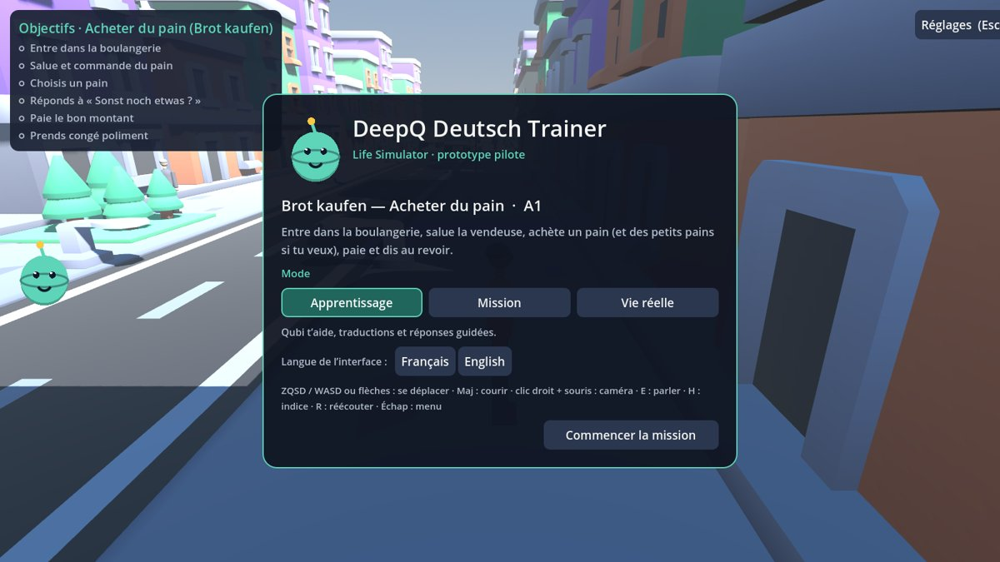
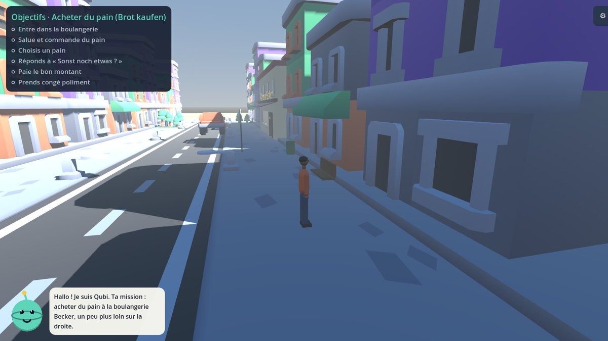
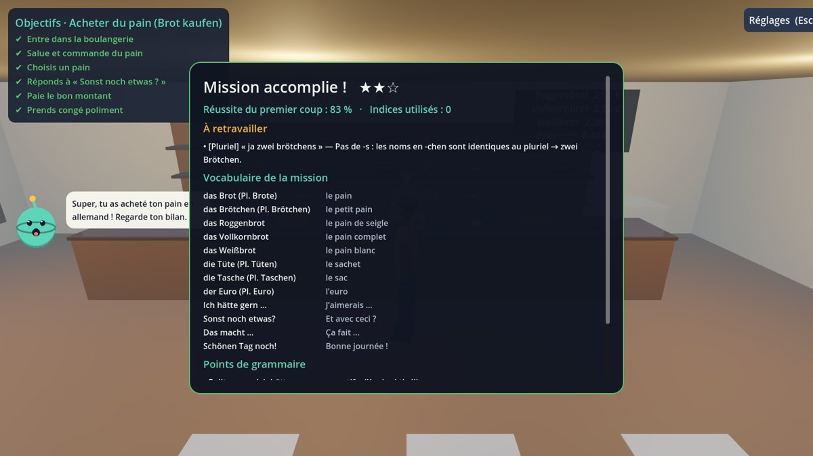

# DeepQ Deutsch Trainer — Life Simulator (prototype pilote)

Premier prototype jouable du **DeepQ Life Simulator**, réalisé d'après le jalon §14 et le livrable pilote §5.5
du cahier des charges consolidé v2.0 : une rue allemande reliée à une boulangerie, un avatar joueur, une vendeuse
et des passants, la circulation et ses bruits, et une mission complète **« Brot kaufen » (acheter du pain)**,
niveau A1.

Moteur : **Godot 4.5.1** (GDScript). Fonctionne **entièrement hors ligne** : aucun compte, aucune donnée envoyée.


| Accueil | Rue | Bilan |
|---|---|---|
|  |  |  |

## Lancer le prototype sous Windows

1. Télécharger **Godot 4.5.1 (Standard, Windows 64 bits)** : https://godotengine.org/download/archive/4.5.1-stable/
   (fichier zip, pas d'installation : décompresser et lancer `Godot_v4.5.1-stable_win64.exe`).
2. Dans le gestionnaire de projets : **Importer** → choisir le fichier `godot/project.godot` de ce dossier.
   Le premier import des modèles et des sons prend environ une minute.
3. Appuyer sur **F5** (ou le bouton ▶ en haut à droite) pour jouer.

## Commandes

| Action | Touche |
|---|---|
| Se déplacer | ZQSD (AZERTY) / WASD (QWERTY) ou flèches |
| Courir | Maj |
| Tourner la caméra / zoom | clic droit maintenu + souris / molette |
| Parler (vendeuse, passant) | E ou Espace |
| Indice de Qubi | H |
| Réécouter la dernière phrase | R |
| Menu des réglages / pause | Échap |

## Ce que contient le pilote (§5.5)

| Exigence du cahier des charges | Réalisation |
|---|---|
| Rue allemande + boulangerie connectées | « Lindenstraße » avec immeubles, trottoirs, lampadaires, bancs, plaque de rue ; boulangerie Becker avec vitrine, auvent, enseigne, intérieur meublé (comptoir vitré, étagères de pains et de bretzels, caisse, machine à café, ardoise des prix). On entre par la porte, la clochette sonne. |
| Avatar joueur, vendeuse et quelques PNJ | Avatar en 3ᵉ personne ; Frau Becker derrière le comptoir ; 4 passants qui marchent, s'arrêtent, regardent le joueur, saluent (« Guten Morgen! », « Hallo! ») ; une cliente dans la boutique. Un passant indique le chemin quand on lui parle. |
| Circulation et bruits | Véhicules sur les deux voies avec moteur **spatialisé et effet Doppler** (une voiture qui approche devient plus audible puis s'éloigne), klaxons occasionnels, ambiance de rue, murmure de foule, oiseaux ; dans la boutique : radio, machine à café, caisse enregistreuse, clochette. La rue est assourdie quand on est à l'intérieur. |
| Mission complète « acheter du pain » | 6 objectifs : entrer, saluer et commander, choisir un pain, répondre à « Sonst noch etwas? », payer le bon montant (compréhension orale des prix), prendre congé. |
| Dialogues en allemand | 23 répliques enregistrées en voix de synthèse allemande (voix féminine pour la vendeuse, masculine pour les passants et les réponses modèles), chacune en version **normale** et **lente**. |
| Réponses guidées ou libres | Choix A/B/C/D **ou** saisie libre au clavier (touches ä ö ü ß à l'écran). Les réponses libres sont analysées hors ligne par des règles (salutation, article, pluriel, politesse, montant) ; les fautes d'umlaut tapé sans clavier allemand sont tolérées. |
| Aide de Qubi | Mascotte (sphère de Bloch avec antenne-vecteur d'état) : accueil, consignes, indices adaptés à chaque étape, encouragements sans culpabilisation. |
| Trois modes (§5.4) | **Apprentissage** (Qubi donne l'indice à chaque étape, traduction affichée), **Mission** (indice sur demande, noté sans pénalité), **Vie réelle** (pas de Qubi ni de traduction par défaut, saisie libre d'abord, réponses guidées en secours, ambiance dense). |
| Réglages audio (§5.3) | Volumes séparés : général, voix, bruitages, ambiance, musique. Ambiance sonore Facile (bruit réduit) / Normale / Immersion dense. **Atténuation automatique** de l'ambiance et de la musique pendant les répliques pédagogiques (priorité à l'intelligibilité). Sous-titres allemands et traduction activables. |
| Retour pédagogique | Feedback immédiat expliqué (vert / orange / rouge), bouton « Écouter un modèle » ; bilan final : réussite du premier coup, indices utilisés, erreurs commentées par catégorie, vocabulaire (avec pluriels) et points de grammaire. |
| Sauvegarde | Fichier local `user://deepq_save.json` (sous Windows : `%APPDATA%\Godot\app_userdata\DeepQ Deutsch Trainer – Life Simulator (Pilot)\`) : réglages, point de reprise à chaque étape, missions terminées, meilleur score, **journal des erreurs**, vocabulaire rencontré. « Reprendre » relance la mission là où on l'avait laissée. |
| Plusieurs niveaux de qualité graphique (§5.1) | Basse / Moyenne / Élevée (ombres, anticrénelage, échelle de rendu, occlusion ambiante). |
| Interface FR/EN | Toute l'interface et les traductions existent en français et en anglais. |

### Ce qui reste provisoire

- **Personnages** : faute de modèles téléchargeables au moment du développement (quota Google Drive dépassé pour les
  packs Quaternius), les humains sont des **personnages provisoires construits par code** (silhouettes animées : marche,
  respiration, gestes en parlant, salut de la main). Ils exposent une petite interface (`set_walk_speed`, `talk`,
  `wave`) pour être remplacés par des modèles riggés réalistes **sans toucher à la logique**. C'est la priorité n° 1
  de l'itération suivante, conformément à la décision « personnages très réalistes » (§5.1).
- **Synchronisation labiale** : non réalisée (à valider sur prototype selon le §5.4).
- **Réponses orales** : la saisie est textuelle ; la reconnaissance vocale locale (STT) est prévue en phase 2.0.
- **Android** : le projet est configuré pour le moteur de rendu mobile, mais les commandes tactiles et l'export APK
  restent à faire.
- **Contenu** : relecture pédagogique par un enseignant d'allemand à prévoir (statut `draft-to-review` dans le JSON).

## Recette (§12)

| ID | Test | État dans le pilote |
|---|---|---|
| R01 | Sans Internet | ✔ aucune ressource réseau |
| R07 | Pilote 3D : déplacement rue-boulangerie, mission et interaction PNJ jouables | ✔ |
| R08 | Audio 3D : voix intelligibles, bruitage contextuel, volumes séparés | ✔ (atténuation automatique pendant les voix) |
| R10 | Sauvegarde | ✔ point de reprise par étape (synchronisation : hors périmètre du pilote) |

Tests automatiques de la logique de mission (32 vérifications : parcours parfait, erreurs, réponses libres,
paiement, indices, reprise) :

```
godot --headless --path godot res://tests/test_mission.tscn
```

## Structure

```
godot/                         projet Godot (ouvrir godot/project.godot)
  data/missions/brot_kaufen.json   contenu pédagogique : répliques, traductions, réponses, règles, vocabulaire
  scripts/main.gd              orchestration (monde, PNJ, voix, mission, interface)
  scripts/mission_runner.gd    logique de mission pilotée par les données (sans dépendance 3D, testable)
  scripts/world.gd             rue + boulangerie
  scripts/player.gd, npc.gd, vehicle.gd, humanoid.gd
  scripts/audio_director.gd    ambiances, presets d'immersion, atténuation des voix
  scripts/hud.gd, qubi.gd      interface, Qubi
  scripts/game_state.gd        réglages, sauvegarde locale, journal d'erreurs
  assets/kenney/               décors et véhicules (CC0)
  assets/audio/                sons synthétisés + voix allemandes générées
  tests/                       tests automatiques
tools/gen_sfx.py               régénère tous les bruitages et ambiances (numpy)
tools/gen_voices.py            régénère les voix d'une mission à partir du JSON (Piper TTS)
docs/screenshots/              captures
ASSETS.md                      provenance et licences de toutes les ressources
```

Ajouter une mission = écrire un nouveau fichier JSON sur le modèle de `brot_kaufen.json`, générer ses voix avec
`tools/gen_voices.py`, puis placer le décor et le PNJ.

## Prochaines étapes proposées

1. Remplacer les personnages provisoires par des modèles réalistes riggés (avatar personnalisable, vendeuse, passants).
2. Commandes tactiles et export Android ; export Windows (.exe).
3. Relecture du contenu par un enseignant, puis deuxième scène (gare ou café).
4. Brancher le DeepQ Tutor local (Ollama / llama.cpp) pour évaluer les réponses libres non prévues par les règles.
