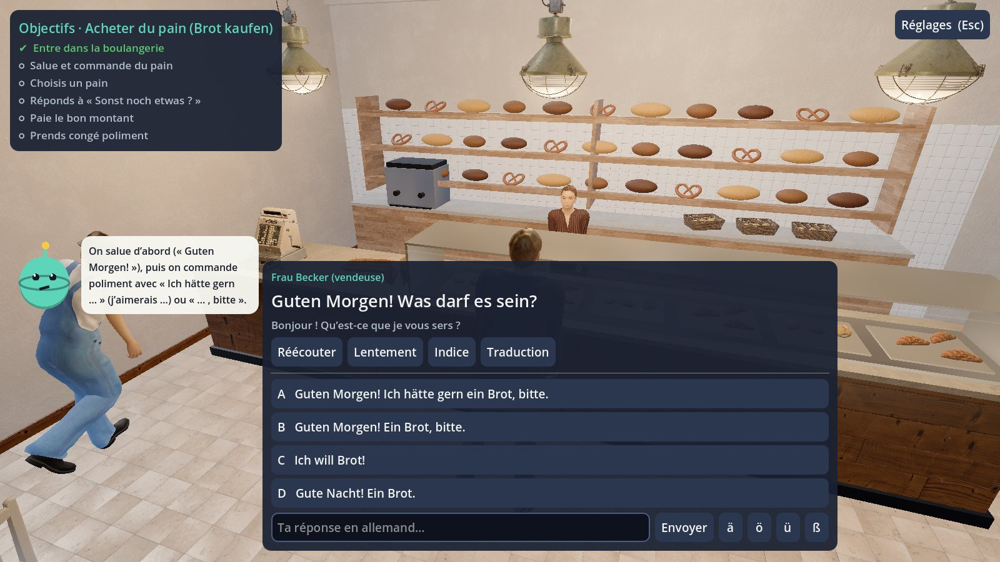
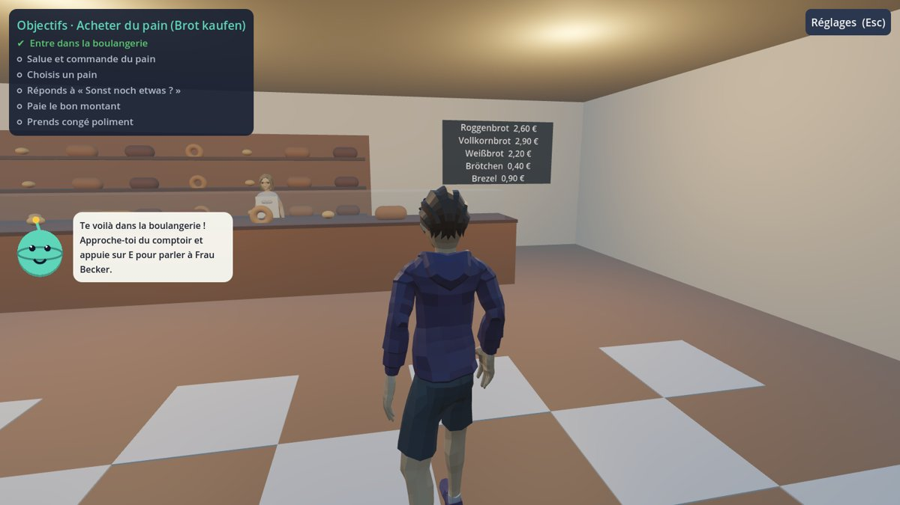

# DeepQ Deutsch Trainer — Life Simulator (pilot prototype)

First playable prototype of the **DeepQ Life Simulator**, built from milestone §14 and pilot deliverable §5.5 of the
consolidated specification v2.0. It contains:

- a German street connected to a bakery;
- a player avatar, a shop assistant and passers-by;
- traffic and its sounds;
- a complete A1-level mission, **"Brot kaufen" (buying bread)**.

Engine: **Godot 4.5.1** (GDScript). It runs **fully offline**: no account, and no data leaves the machine.



| Start screen | Street | Results |
|---|---|---|
|  |  |  |



## Running the prototype on Windows

1. Download **Godot 4.5.1 (Standard, Windows 64-bit)**: https://godotengine.org/download/archive/4.5.1-stable/
   It is a zip with no installer: extract it and run `Godot_v4.5.1-stable_win64.exe`. Later 4.x versions also work.
2. In the Project Manager, click **Import** and choose `godot/project.godot` in this folder.
   The first import of the models and sounds takes about a minute.
3. Press **F5** (or the ▶ button at the top right) to play.

## Controls

| Action | Key |
|---|---|
| Move | WASD (QWERTY) / ZQSD (AZERTY) or arrow keys |
| Run | Shift |
| Orbit camera / zoom | hold right mouse button + move / mouse wheel |
| Talk (shop assistant, passer-by) | E or Space |
| Hint from Qubi | H |
| Replay the last line | R |
| Settings / pause | Esc |

## What the pilot contains (§5.5)

| Specification requirement | Implementation |
|---|---|
| German street + bakery, connected | The street is "Lindenstraße", with apartment blocks, pavements, street lamps, benches and a street sign.<br>Bäckerei Becker has a shop window, an awning, a sign and a furnished interior: glass counter, shelves of bread and pretzels, till, coffee machine and a price board.<br>You enter through the door, and the bell rings. |
| Player avatar, shop assistant and a few NPCs | Characters are rigged and animated humans from Quaternius' CC0 *Ultimate Modular Men/Women* packs. They walk, run, idle, wave and gesture while speaking.<br>The player is a third-person avatar in a hoodie, and Frau Becker stands behind the counter.<br>Four passers-by walk, stop, look at the player and greet them ("Guten Morgen!", "Hallo!"). One gives directions when spoken to.<br>One more customer is inside the shop. |
| Traffic and sounds | Vehicles drive in both lanes. Their engines are **spatialised with Doppler**, so a car gets louder as it approaches and fades as it drives off.<br>The street also has occasional horns, ambience, crowd murmur and birds.<br>The shop has a radio, a coffee machine, a till and a door bell. Street noise is muffled indoors. |
| Complete "buy bread" mission | Six objectives:<br>1. Enter the shop.<br>2. Greet the assistant and order.<br>3. Choose a bread.<br>4. Answer "Sonst noch etwas?".<br>5. Pay the right amount, which tests listening comprehension of prices.<br>6. Say goodbye. |
| Dialogue in German | 23 lines are voiced with German speech synthesis. The shop assistant has a female voice; passers-by and model answers have a male voice.<br>Each line has a **normal** and a **slow** version. |
| Guided or free answers | Answer by choosing A/B/C/D **or** by typing freely, with on-screen ä ö ü ß keys.<br>Free answers are checked offline by rules covering greeting, article, plural, politeness and amount.<br>Umlauts typed without a German keyboard (ae, oe, ue) are accepted. |
| Help from Qubi | Qubi is the mascot, a Bloch sphere with a state-vector antenna.<br>It welcomes the player, gives instructions and step-specific hints, and encourages without guilt-tripping. |
| Three modes (§5.4) | **Learning**: Qubi gives a hint at every step, and the translation is shown.<br>**Mission**: hints are available on request and recorded without penalty.<br>**Real life**: no Qubi or translation by default. Free typing comes first, with guided answers as a fallback, and the ambience is dense. |
| Audio settings (§5.3) | Separate volumes for master, voice, SFX, ambience and music.<br>Ambience presets are Easy (reduced noise), Normal and Dense immersion.<br>Ambience and music are **ducked automatically** during teaching lines, so speech stays intelligible.<br>German subtitles and the translation can be switched on or off. |
| Learning feedback | Each answer gets immediate, explained feedback in green, orange or red, plus a "Listen to a model answer" button.<br>The end-of-mission report shows first-try success, hints used, errors explained by category, vocabulary (with plurals) and grammar points. |
| Saving | Everything is stored in the local file `user://deepq_save.json`. On Windows, that is `%APPDATA%\Godot\app_userdata\DeepQ Deutsch Trainer – Life Simulator (Pilot)\`.<br>It holds the settings, a checkpoint at every step, completed missions, the best score, an **error log** and the vocabulary met.<br>"Resume" restarts the mission where you left off. |
| Several graphics quality levels (§5.1) | Low, Medium and High, which change shadows, anti-aliasing, render scale and ambient occlusion. |
| FR/EN interface | The whole interface and every translation exist in French and English. |

### What is still provisional

- **Characters**: the models are stylised low-poly (Quaternius, CC0). They are believable, but not yet "highly realistic" as §5.1 asks.
  - They go through a common interface (`set_walk_speed`, `talk`, `wave`), so realistic avatars can replace them without touching the game logic.
  - The procedural figures in `humanoid.gd` remain as a fallback in case a model is missing.
- **Lip sync**: not implemented yet. §5.4 says to validate it on a prototype first.
- **Spoken answers**: answers are typed for now. Local speech recognition (STT) is planned for phase 2.0.
- **Android**: the project already uses the mobile renderer on Android. Touch controls and the APK export are still to do.
- **Content**: a German teacher still needs to review it. Its status in the JSON is `draft-to-review`.

## Acceptance tests (§12)

| ID | Test | Status in the pilot |
|---|---|---|
| R01 | Works without Internet | ✔ no network resources |
| R07 | 3D pilot: walking between street and bakery, mission and NPC interaction are playable | ✔ |
| R08 | 3D audio: intelligible voices, contextual sound effects, separate volumes | ✔ (automatic ducking during speech) |
| R10 | Saving | ✔ checkpoint at every step (sync is out of scope for the pilot) |

Automated tests of the mission logic run 32 checks. They cover a perfect run, mistakes, free answers, payment, hints and resuming:

```
godot --headless --path godot res://tests/test_mission.tscn
```

## Project layout

```
godot/                         Godot project (open godot/project.godot)
  data/missions/brot_kaufen.json   teaching content: lines, translations, answers, rules, vocabulary
  scripts/main.gd              orchestration (world, NPCs, voices, mission, UI)
  scripts/mission_runner.gd    data-driven mission logic (no 3D dependency, testable)
  scripts/world.gd             street + bakery
  scripts/player.gd, npc.gd, vehicle.gd
  scripts/character_model.gd   rigged characters (Quaternius); humanoid.gd = procedural fallback
  scripts/audio_director.gd    ambiences, immersion presets, voice ducking
  scripts/hud.gd, qubi.gd      user interface, Qubi
  scripts/game_state.gd        settings, local save, error log
  assets/kenney/               scenery and vehicles (CC0)
  assets/quaternius/           rigged, animated characters (CC0)
  assets/audio/                synthesised sounds + generated German voices
  tests/                       automated tests
tools/gen_sfx.py               regenerates all sound effects and ambiences (numpy)
tools/gen_voices.py            regenerates a mission's voices from its JSON (Piper TTS)
docs/screenshots/              screenshots
ASSETS.md                      origin and licence of every asset
```

To add a mission:

1. Write a new JSON file modelled on `brot_kaufen.json`.
2. Generate its voices with `tools/gen_voices.py`.
3. Place the scenery and the NPC.

## Suggested next steps

1. Avatar customisation (choice among the Quaternius outfits), then a move to more realistic avatars.
2. Touch controls and the Android export; Windows (.exe) export.
3. Teacher review of the content, then a second scene (train station or café).
4. Connect the local DeepQ Tutor (Ollama / llama.cpp) to assess free answers the rules do not cover.
