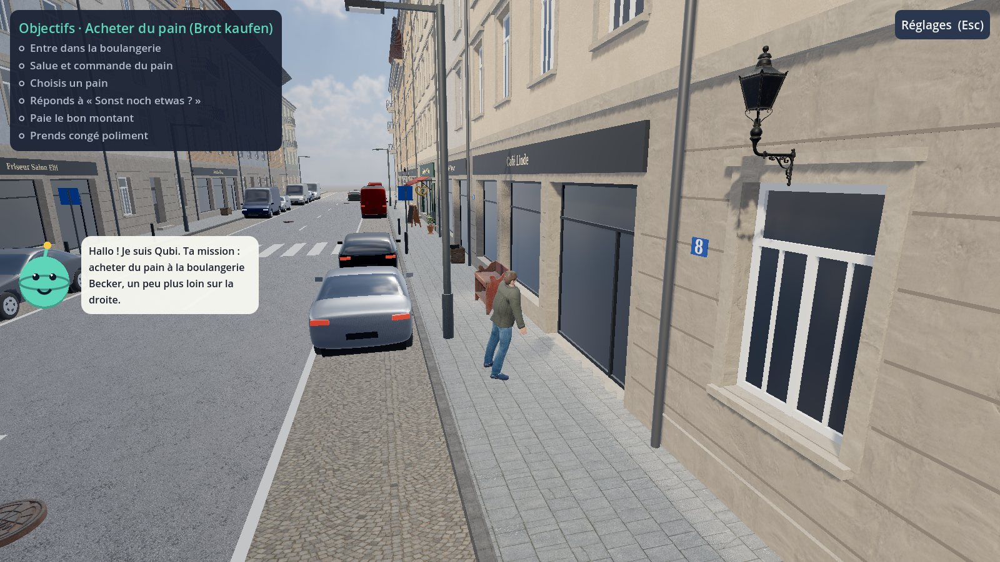
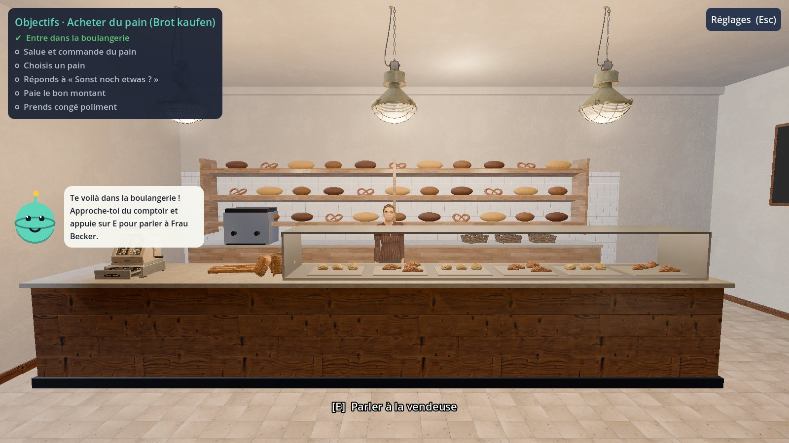
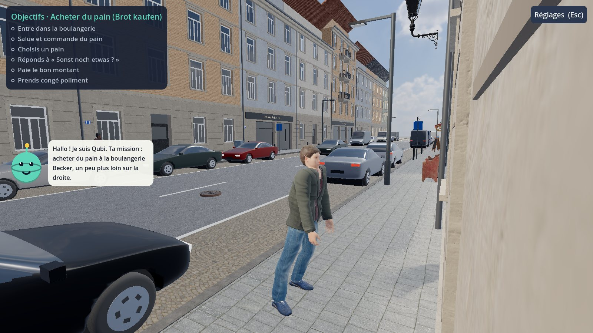

# DeepQ Deutsch Trainer — Life Simulator (pilot prototype)

First playable prototype of the **DeepQ Life Simulator**, built from milestone §14 and pilot deliverable §5.5 of the
consolidated specification v2.0. It contains:

- a German street connected to a bakery;
- a player avatar, a shop assistant and passers-by;
- traffic and its sounds;
- a complete A1-level mission, **"Brot kaufen" (buying bread)**.

Engine: **Godot 4.5.1** (GDScript). It runs **fully offline**: no account, and no data leaves the machine.

The look is **photorealistic**:

- **Scenery**: scanned PBR materials, an HDRI sky and Gründerzeit façades.
- **People**: realistic human characters moving with **real motion capture**.
- **Cars**: modelled cars with clear-coat paint.



| Bäckerei Becker | Inside the shop |
|---|---|
|  |  |
| **Talking to Frau Becker** | **Passers-by and traffic** |
|  |  |

## Running the prototype on Windows

1. Download **Godot 4.5.1 (Standard, Windows 64-bit)**: https://godotengine.org/download/archive/4.5.1-stable/
   It is a zip with no installer: extract it and run `Godot_v4.5.1-stable_win64.exe`. Later 4.x versions also work.
2. In the Project Manager, click **Import** and choose `godot/project.godot` in this folder.
   The first import of the models and sounds takes about a minute.
3. Press **F5** (or the ▶ button at the top right) to play.

A graphics card from roughly 2016 or later is recommended. In **Settings (Esc) → Graphics quality** you can choose:

| Level | What it renders |
|---|---|
| Low | For weak or integrated GPUs |
| Medium | — |
| High | **Default**: ambient occlusion, indirect light and reflections |
| Ultra | Adds real-time global illumination and volumetric light |

## Controls

| Action | Key |
|---|---|
| Move | WASD (QWERTY) / ZQSD (AZERTY) or arrow keys |
| Run | Shift |
| Orbit camera / zoom | hold right mouse button + move / mouse wheel |
| Talk (shop assistant, passer-by) | E or Space |
| Hint from Qubi | H |
| Replay the last line | R |
| Settings / pause | Esc |

## What the pilot contains (§5.5)

| Specification requirement | Implementation |
|---|---|
| German street + bakery, connected | **Lindenstraße** is a row of Gründerzeit apartment houses, generated from parameters (width, floors, colour, shop or entrance on the ground floor):<br>• Façades: plaster or brick, stone window surrounds, double casement windows, balconies with railings, cornices, tiled roofs, chimneys, gutters, blue enamel house numbers.<br>• Ground floors: shops with signs (pharmacy, florist, bookshop…).<br>• Street: asphalt with lane markings, cobbled parking lanes, granite kerbs, concrete paving slabs, a zebra crossing with its sign, street lights, bollards, benches and a street-name sign.<br>**Bäckerei Becker** is on the ground floor of house no. 12:<br>• Outside: green shopfront, gilded lettering, red awning, hanging pretzel sign, an A-board on the pavement.<br>• Inside: tiled floor, wooden sales counter with a glass vitrine of croissants and rolls, slanted bread shelves (rye, whole-grain and white loaves, pretzels), coffee machine, till, café table, pendant lamps, and a chalkboard price list.<br>You enter through the open door, and the bell rings. |
| Player avatar, shop assistant and a few NPCs | **Realistic people** built with MakeHuman (CC0), with skin, eyes, hair and clothes. They vary in sex, age and origin: the player, Frau Becker, four passers-by and an older customer in the shop.<br>**Motion capture**: walking, running, idling, waiting, talking and waving come from the CMU motion-capture database, retargeted onto each body.<br>• Walk and run speeds match the recorded strides, so feet do not slide.<br>• People **turn their head towards you** when you come close.<br>• Frau Becker uses conversational gestures while she speaks.<br>Passers-by stop, greet you ("Guten Morgen!", "Hallo!"), and one gives directions when spoken to. |
| Traffic and sounds | Cars are modelled for the project: a hatchback, a saloon and a delivery van.<br>• They have clear-coat paint in typical German colours, glass, lights, spinning wheels and German number plates.<br>• They drive on the right in both lanes, and more cars are parked along both kerbs.<br>Engines are **spatialised with Doppler**, so a car gets louder as it approaches and fades as it drives off.<br>The street also has occasional horns, ambience, crowd murmur and birds.<br>The shop has a radio, a coffee machine, a till and a door bell. Street noise is muffled indoors. |
| Complete "buy bread" mission | Six objectives:<br>1. Enter the shop.<br>2. Greet the assistant and order.<br>3. Choose a bread.<br>4. Answer "Sonst noch etwas?".<br>5. Pay the right amount, which tests listening comprehension of prices.<br>6. Say goodbye. |
| Dialogue in German | 23 lines are voiced with German speech synthesis. The shop assistant has a female voice; passers-by and model answers have a male voice.<br>Each line has a **normal** and a **slow** version. |
| Guided or free answers | Answer by choosing A/B/C/D **or** by typing freely, with on-screen ä ö ü ß keys.<br>Free answers are checked offline by rules covering greeting, article, plural, politeness and amount.<br>Umlauts typed without a German keyboard (ae, oe, ue) are accepted. |
| Help from Qubi | Qubi is the mascot, a Bloch sphere with a state-vector antenna.<br>It welcomes the player, gives instructions and step-specific hints, and encourages without guilt-tripping. |
| Three modes (§5.4) | **Learning**: Qubi gives a hint at every step, and the translation is shown.<br>**Mission**: hints are available on request and recorded without penalty.<br>**Real life**: no Qubi or translation by default. Free typing comes first, with guided answers as a fallback, and the ambience is dense. |
| Audio settings (§5.3) | Separate volumes for master, voice, SFX, ambience and music.<br>Ambience presets are Easy (reduced noise), Normal and Dense immersion.<br>Ambience and music are **ducked automatically** during teaching lines, so speech stays intelligible.<br>German subtitles and the translation can be switched on or off. |
| Learning feedback | Each answer gets immediate, explained feedback in green, orange or red, plus a "Listen to a model answer" button.<br>The end-of-mission report shows first-try success, hints used, errors explained by category, vocabulary (with plurals) and grammar points. |
| Saving | Everything is stored in the local file `user://deepq_save.json`. On Windows, that is `%APPDATA%\Godot\app_userdata\DeepQ Deutsch Trainer – Life Simulator (Pilot)\`.<br>It holds the settings, a checkpoint at every step, completed missions, the best score, an **error log** and the vocabulary met.<br>"Resume" restarts the mission where you left off. |
| Photorealistic rendering, several quality levels (§5.1) | • Lighting: HDRI sky with image-based light and reflections, sun with soft cascaded shadows.<br>• Tone and atmosphere: AgX tone mapping, auto-exposure (stepping from the bright street into the shop adapts like an eye), and aerial perspective.<br>• Materials: scanned PBR (colour, normal, roughness, AO).<br>• Screen-space effects: ambient occlusion, indirect light and reflections; a reflection probe in the shop; subsurface scattering on skin.<br>• Quality levels: Low, Medium, High and Ultra (real-time global illumination). |
| FR/EN interface | The whole interface and every translation exist in French and English. |

### What is still provisional

- **Characters**: MakeHuman people are realistic but not "film" quality.
  - Faces have no expressions yet.
  - The CC0 clothing set is small: a few outfits, including T-shirts with the MakeHuman logo.
  - Higher-end scanned avatars could replace them through the same interface (`set_walk_speed`, `talk`, `wave`).
- **Trees**: there are none yet. The free scanned trees are far too heavy for a game.
- **Lip sync**: not implemented yet. §5.4 says to validate it on a prototype first.
- **Spoken answers**: answers are typed for now. Local speech recognition (STT) is planned for phase 2.0.
- **Android**: the project already uses the mobile renderer on Android. Touch controls and the APK export are still to do.
- **Content**: a German teacher still needs to review it. Its status in the JSON is `draft-to-review`.

## Acceptance tests (§12)

| ID | Test | Status in the pilot |
|---|---|---|
| R01 | Works without Internet | ✔ no network resources |
| R07 | 3D pilot: walking between street and bakery, mission and NPC interaction are playable | ✔ |
| R08 | 3D audio: intelligible voices, contextual sound effects, separate volumes | ✔ (automatic ducking during speech) |
| R10 | Saving | ✔ checkpoint at every step (sync is out of scope for the pilot) |

Automated tests of the mission logic run 32 checks. They cover a perfect run, mistakes, free answers, payment, hints and resuming:

```
godot --headless --path godot res://tests/test_mission.tscn
```

## Project layout

```
godot/                         Godot project (open godot/project.godot)
  data/missions/brot_kaufen.json   teaching content: lines, translations, answers, rules, vocabulary
  scripts/main.gd              orchestration (world, NPCs, cars, voices, mission, UI)
  scripts/mission_runner.gd    data-driven mission logic (no 3D dependency, testable)
  scripts/world.gd             street, façade generator, bakery, lighting and quality levels
  scripts/mesh_builder.gd      merges thousands of boxes into one mesh per material
  scripts/character_model.gd   realistic animated characters; humanoid.gd = procedural fallback
  scripts/head_look.gd         head/neck turn towards the player on top of the mocap
  scripts/player.gd, npc.gd, vehicle.gd
  scripts/audio_director.gd    ambiences, immersion presets, voice ducking
  scripts/hud.gd, qubi.gd      user interface, Qubi
  scripts/game_state.gd        settings, local save, error log
  assets/characters/           MakeHuman people with mocap animations (generated, see below)
  assets/vehicles/             procedural cars (generated)
  assets/pbr/                  scanned PBR materials (ambientCG, CC0)
  assets/props/                scanned props (Poly Haven, CC0)
  assets/sky/                  HDRI sky (Poly Haven, CC0)
  assets/audio/                synthesised sounds + generated German voices
  tests/                       automated tests; lineup.tscn shows all characters side by side
tools/build_characters.sh      builds every character: mh_build.py (MakeHuman body, skin, hair,
                               clothes, rig) then mh_animate.py (CMU mocap retargeting, export)
tools/make_cars.py             builds the three car models (Blender)
tools/fetch_assets.py          downloads the CC0 textures, sky and props
tools/gen_sfx.py               regenerates all sound effects and ambiences (numpy)
tools/gen_voices.py            regenerates a mission's voices from its JSON (Piper TTS)
docs/screenshots/              screenshots
ASSETS.md                      origin and licence of every asset
```

The generated assets are committed, so the game runs as is. To rebuild them, you need two things:

- Blender's Python module: `pip install bpy`.
- The MPFB2 extension with the CC0 *makehuman_system_assets* pack.

The header of each tool explains the steps.

To add a mission:

1. Write a new JSON file modelled on `brot_kaufen.json`.
2. Generate its voices with `tools/gen_voices.py`.
3. Place the scenery and the NPC.

## Suggested next steps

1. Avatar customisation: body, skin, hair and outfit, generated with the same MakeHuman pipeline.
2. Facial expressions and lip sync for Frau Becker.
3. Lightweight realistic trees and more street life: cyclists and people sitting at the café.
4. Touch controls and the Android export; Windows (.exe) export.
5. Teacher review of the content, then a second scene (train station or café).
6. Connect the local DeepQ Tutor (Ollama / llama.cpp) to assess free answers the rules do not cover.
