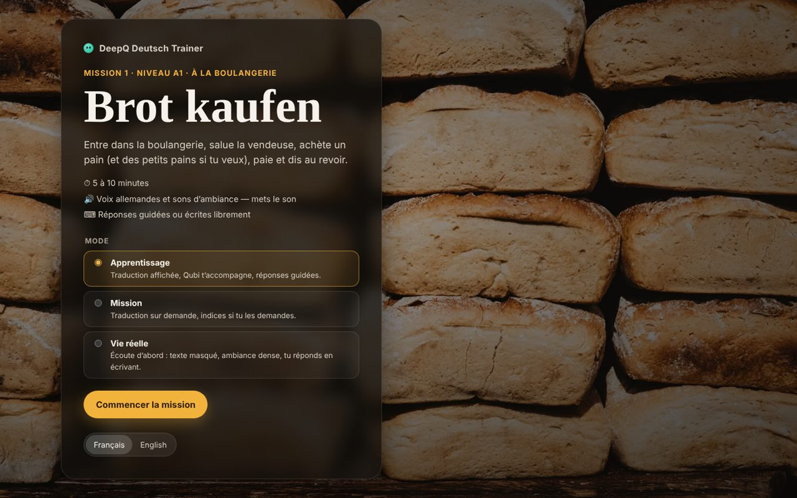
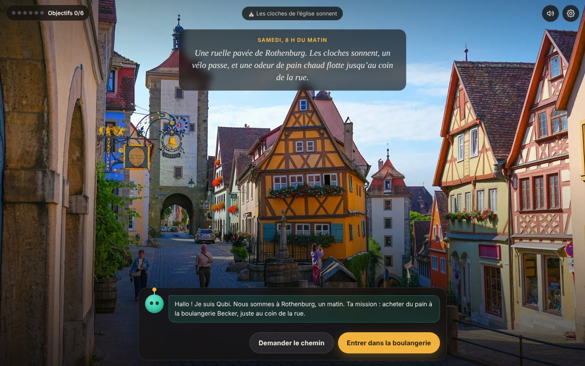
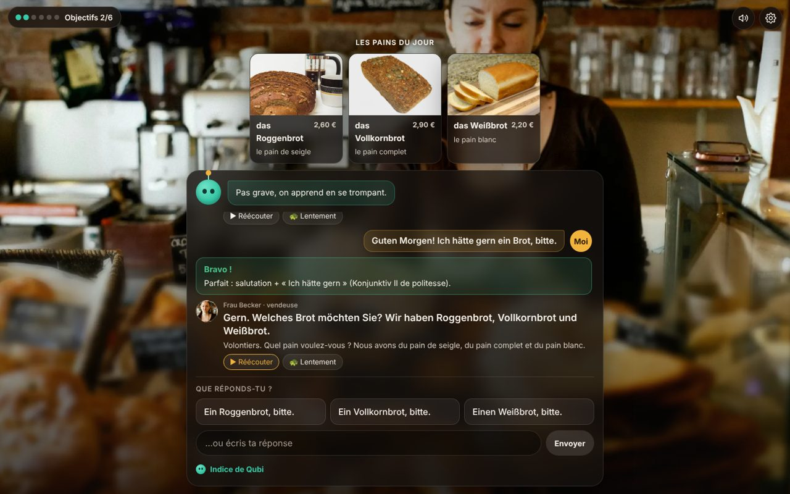
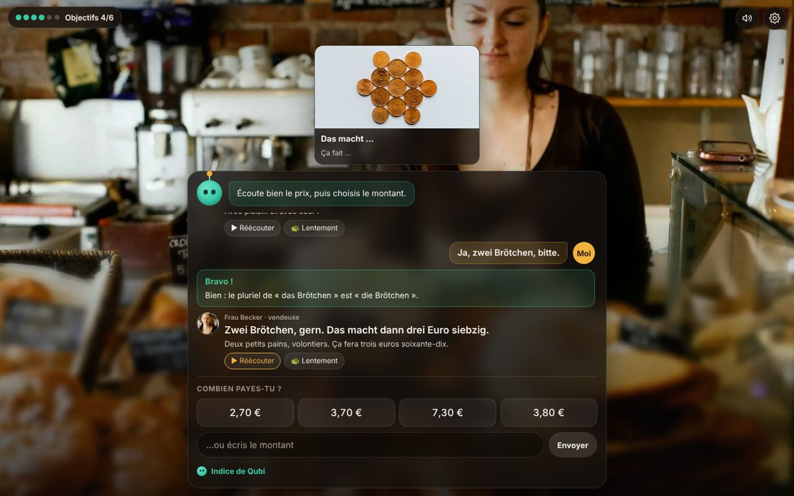
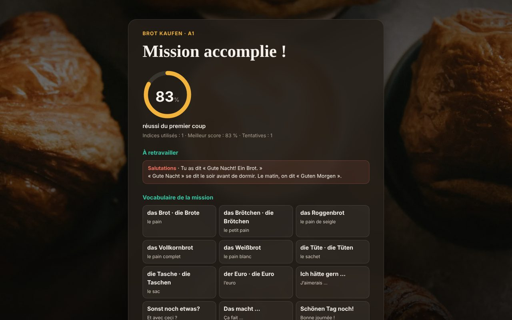
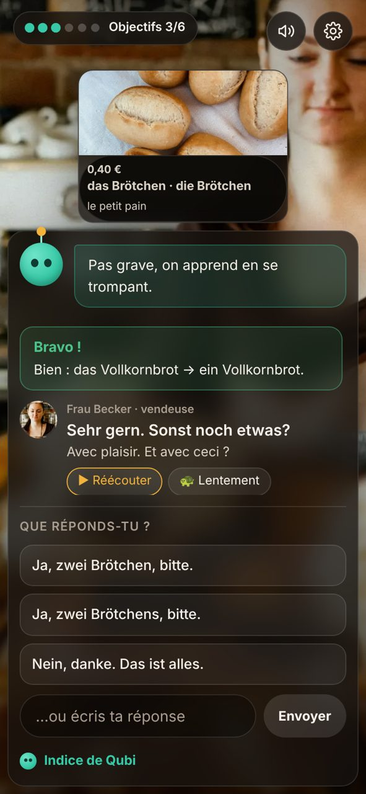

# DeepQ Deutsch Trainer — Life Simulator (pilot)

Pilot of the **DeepQ Life Simulator** (specification v2.0, §5.5): a German street connected to a bakery and a
complete A1 mission, **"Brot kaufen" (buying bread)**.

**Design decision (14 November 2026): no 3D for now.** The simulator plays on the learner's imagination with
**photos, sound and atmosphere**: real photographs of each place, German voices, a living soundscape (street,
church bells, passing cars and bikes, the shop bell, the coffee machine, cups, the bread knife, the till, coins,
the paper bag) and a short line of scene-setting text. The earlier animated 3D prototype (Godot) is kept on the
branch `archive-3d-pilot`.

| Title and modes | Street | Choosing bread |
|---|---|---|
|  |  |  |
| **Paying** | **Summary** | **Mobile** |
|  |  |  |

## Playing

Double-click `web/index.html` (Chrome, Edge, Firefox or Safari, on Windows, Android, macOS or iOS),
or serve the `web/` folder with any static web server (`cd web && python -m http.server 8000`).
No account, no Internet needed once the files are on the device; progress is saved in the browser.

## What the mission contains

- **Street** (Rothenburg, Saturday morning): Qubi explains the mission; you can ask a passer-by the way.
- **Bakery**: the door bell rings, Frau Becker greets you. You order, choose a loaf (Roggenbrot, Vollkornbrot,
  Weißbrot), answer "Sonst noch etwas?", listen to the price and pay, accept or refuse a bag, say goodbye.
- **Answers**: guided answers or free typing (umlauts optional: "Brotchen" = "Brötchen"). Each answer gets an
  explanation; wrong or approximate answers come with the right wording to listen to.
- **Help**: replay, slow replay, translation, Qubi's hints; objectives with progress dots.
- **Modes** (§5.4): *Learning* (translation shown, Qubi helps, quiet soundscape), *Mission* (translation on
  request, normal soundscape), *Real life* (German text hidden until tapped, guided answers hidden until asked
  for, dense soundscape).
- **Soundscape** (§5.3): separate volumes for voices, effects and ambience; three levels (easy / normal / dense);
  the ambience ducks automatically under every voice line; captions for sounds ("🔔 The door bell chimes").
- **Summary**: first-try score, errors with explanations, the mission's vocabulary and grammar points.
- Interface in French or English.

## Project layout

```
web/index.html            the app (static files only)
web/js/mission.js         mission engine: dialogue nodes, answer rules, objectives, score, checkpoint
web/js/app.js             scenes, dialogue UI, soundscape, modes, settings
web/js/i18n.js            interface strings (FR/EN)
web/data/brot_kaufen.json mission content (German lines, translations, answers, rules, vocabulary)
web/data/brot_kaufen.js   same data as a script, so index.html also runs from disk (tools/web_data.py)
web/img, web/audio        photos (WebP), voices and sounds (MP3)
web/CREDITS.md            source and licence of every photo and sound
web/tests/                engine tests (node web/tests/mission.test.js)
tools/gen_voices.py       German voices with Piper TTS (offline)
tools/gen_sfx.py          synthesised interface sounds
tools/web_data.py         rebuilds web/data/*.js after editing a mission JSON
```

Adding a place = a few photos + an ambience and its background events (`SCENES` in `app.js`) + a mission JSON
+ its voice lines.

## Acceptance tests (§12)

| ID | Test | Status |
|---|---|---|
| R01 | Works without Internet | ✔ only local files |
| R07 | Pilot: street → bakery, mission and interaction with the shop assistant playable | ✔ (photo scenes instead of 3D) |
| R08 | Audio: intelligible voices, contextual sound effects, separate volumes | ✔ ducking under speech, 3 levels |
| R10 | Saving | ✔ checkpoint at every step, error journal (sync out of scope) |

`node web/tests/mission.test.js` runs 35 checks: a perfect run, mistakes, free answers, compound bread names,
payment, hints and resuming.

## Licences

Photos: Unsplash and Pixabay licences. Sounds: BigSoundBank (CC0). Voices: Piper TTS with CC0-trained voices.
Details in `web/CREDITS.md`.
